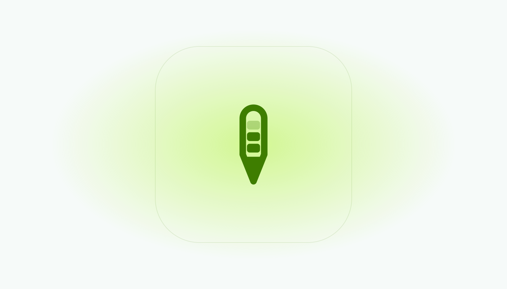
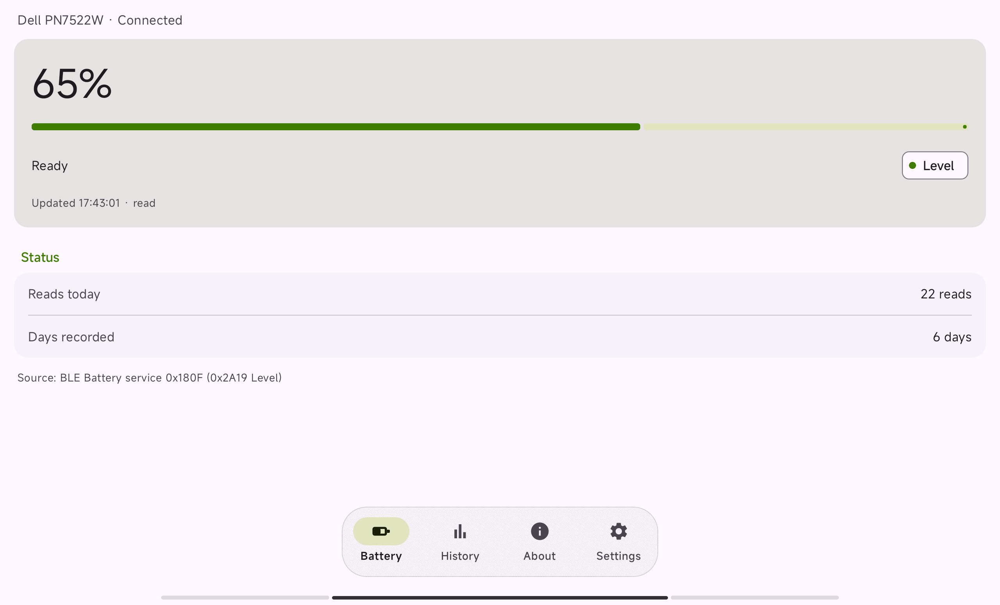
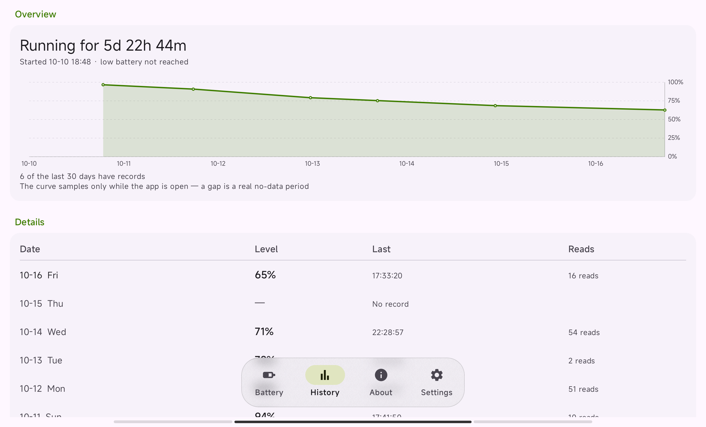
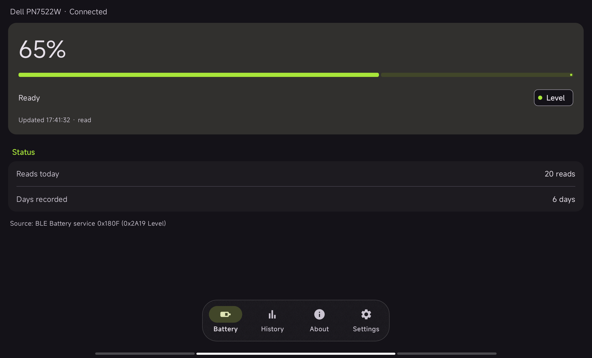
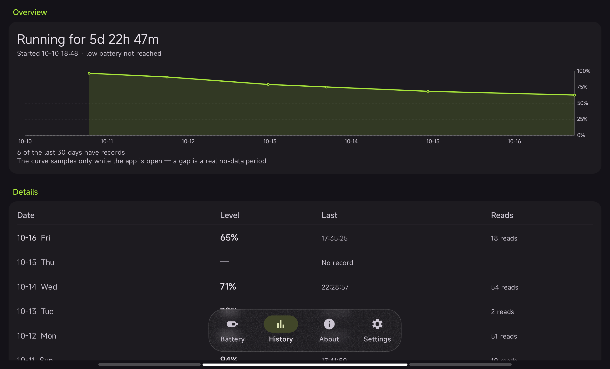

<div align="center">

<picture>
  <source media="(prefers-color-scheme: dark)" srcset="docs/images/Hero-dark.svg">
  
</picture>

# 🔋 Pen Battery

**通过蓝牙低功耗在 Android 上读取触控笔电量** —— 包括系统界面本不显示该数值的情况。

[English](README.md) · **简体中文**

[](LICENSE)


</div>

> 本项目全程由 AI 辅助生成 —— 代码、文档与工具链皆然 —— 由人主导方向，功能行为在真机上验证。

| | | | |
|:---:|:---:|:---:|:---:|
| 🔌 **标准 GATT**<br>`0x180F` → `0x2A19` | 📴 **天生离线**<br>不申请 `INTERNET` | 🗣️ **两种语言**<br>跟随系统 | 🧭 **运行时定目标**<br>不写死地址 |

<details open>
<summary>📖 目录</summary>

- [📥 安装](#-安装)
- [📸 界面截图](#-界面截图)
- [✨ 功能](#-功能)
- [🔒 权限与隐私](#-权限与隐私)
- [📱 支持设备](#-支持设备)
- [⚠️ 限制](#-限制)
- [🧱 实现要点](#-实现要点)
- [🤝 参与开发](#-参与开发)
- [📚 第三方库声明](#-第三方库声明)
- [📜 许可证](#-许可证)

</details>

触控笔通过标准蓝牙电池服务（`0x180F`）上报电量，但平板的蓝牙栈未必订阅该服务的 Battery Level 特征
（`0x2A19`），于是系统设置里看不到这个数值。本应用直接经 GATT 订阅，并把读数保存在本地。

- 不联网：Manifest 未声明 `INTERNET` 权限。
- 目标设备在运行时选定，不在构建时固定；目前仅对 Dell PN7522W 完成验证。
- 中英双语，默认跟随系统语言。

## 📥 安装

请从本仓库的 **Releases** 页面安装已构建好的安装包：最新标签（当前为 `v2.7.2`，versionCode 67）下
附带的 `app-release.apk`。它由项目发布密钥签名 —— 签名证书 SHA-1 为
`4374fe36ebc1326bc9be2e338ecfaae675e6de3a` —— 后续版本沿用同一把密钥，因此覆盖安装会保留已记录的历史。

从源码构建：

```bash
git clone https://github.com/NotRealRobot/pen-battery.git && cd pen-battery/gradle-app
./gradlew :app:assembleDebug          # Windows 使用 gradlew.bat :app:assembleDebug
adb install -r app/build/outputs/apk/debug/app-debug.apk
```

平板需 Android 13（API 33）及以上；构建需 JDK 17+ 与 Android SDK，Gradle 由 wrapper 提供。
release 签名与构建环境细节见 [CONTRIBUTING.zh-CN.md](CONTRIBUTING.zh-CN.md)。

## 📸 界面截图

界面整体遵循 Material 3：表面色随深浅色主题切换，悬浮导航胶囊对下方内容做**实时高斯模糊**。

| ☀️ 电量页 | ☀️ 记录页 |
|:---:|:---:|
|  |  |
| 🌙 电量页 | 🌙 记录页 |
|  |  |

## ✨ 功能

| | |
|---|---|
| 🔋 实时电量 | 订阅 Battery Level（`0x2A19`），收到通知即更新；不通知时以 60 秒一次的读取兜底。 |
| ⏱️ 本轮续航 | 自最近一次 100% 读数起，至其后第一次 ≤10% 读数为止的时长。 |
| 📈 历史记录 | 一天一个点的趋势曲线，以及按天明细表（当天最后值与读取次数）。 |
| 📤 导出 | 经系统文件选择器导出 CSV。 |
| 🧹 清空 | 删除全部已存记录。 |
| 🗣️ 语言 | 英文与简体中文；默认跟随系统，可在应用内更改，由系统持久化。 |
| 🎨 界面 | Material 3 组件、深浅色主题，悬浮导航胶囊带实时高斯模糊。 |

## 🔒 权限与隐私

| | |
|---|---|
| 申请的权限 | `BLUETOOTH_CONNECT` —— 唯一的运行时权限。合并后的 Manifest 另有一条 AndroidX 为自己注册接收器而声明的应用内部权限，不授予任何本应用之外的访问。 |
| 未申请 | 定位、相机、麦克风、存储、`BLUETOOTH_SCAN`、`BLUETOOTH_ADMIN`。不进行设备扫描：仅可选择已配对的设备。 |
| 网络 | 未声明 `INTERNET` 权限，因此无法建立 socket 连接；无统计、无遥测、无崩溃上报。 |
| 存储 | 记录仅保存在应用私有目录。`android:allowBackup="false"`。 |
| 关于页 | 显示所选设备的名称与完整蓝牙地址。 |

完整声明见 [AndroidManifest.xml](gradle-app/app/src/main/AndroidManifest.xml)：一条 `uses-permission`
声明与一个 activity。

## 📱 支持设备

实测环境为 Dell PN7522W 触控笔与小米平板 5（Android 13 / API 33）。读取实现不绑定具体型号：
凡暴露电池服务（`0x180F`）且其 Battery Level 特征（`0x2A19`）支持读与通知的设备都在覆盖范围内，
但目前只有这一对设备有实际数据支撑。

目标设备在运行时解析：优先使用此前选择且仍在配对列表中的设备，其次按常见触控笔名称关键字匹配，
都不可用时弹出选择对话框。对未验证的型号，电量、趋势曲线、按天明细与数据来源四处面板会被遮罩覆盖，
且不发起 GATT 连接，未经验证的数值因此不会写入历史记录。

## ⚠️ 限制

- 仅在应用处于前台时采样。没有前台服务、开机自启与常驻通知；曲线上的断口即数据缺失时段。
- 每天记录一个点。
- 本轮续航需在观察到两个端点（100% 与 ≤10%）之后才判定完成。
- 电量由设备固件上报（0–100），本应用不做换算。
- 部分厂商固件上报的蓝牙适配器状态不可靠。

## 🧱 实现要点

订阅 `0x180F` → `0x2A19`、启用 CCCD 描述符、在每次回调与每 60 秒记录一次数值、按天持久化、断线后退避重连。
12 个 Java 文件、约 2 200 行；逐文件职责见 [CONTRIBUTING.zh-CN.md](CONTRIBUTING.zh-CN.md#源码地图)。

## 🤝 参与开发

欢迎提交 issue 与 pull request。[CONTRIBUTING.zh-CN.md](CONTRIBUTING.zh-CN.md)（另有一份
[英文版](CONTRIBUTING.md)）说明了构建环境、翻译约束
（两份 `strings.xml` 的键集必须完全一致），以及新增权限须有具体理由的原则。

## 📚 第三方库声明

release 运行时 classpath 上的直接与传递依赖均为 Apache-2.0 许可，不含 GPL 或 LGPL 组件。

| 库 | 版本 | 许可证 |
|---|---|---|
| [Material Components for Android](https://github.com/material-components/material-components-android) | 1.14.0 | Apache-2.0 |
| [AndroidX](https://android.googlesource.com/)（constraintlayout、swiperefreshlayout、appcompat 及传递依赖） | 各版本 | Apache-2.0 |
| [BlurView](https://github.com/Dimezis/BlurView) | 3.2.0 | Apache-2.0 |
| [MPAndroidChart](https://github.com/PhilJay/MPAndroidChart) | 3.1.0 | Apache-2.0 |
| Kotlin stdlib、kotlinx.coroutines | 各版本 | Apache-2.0 |

## 📜 许可证

本项目采用 [MIT 许可证](LICENSE)。
